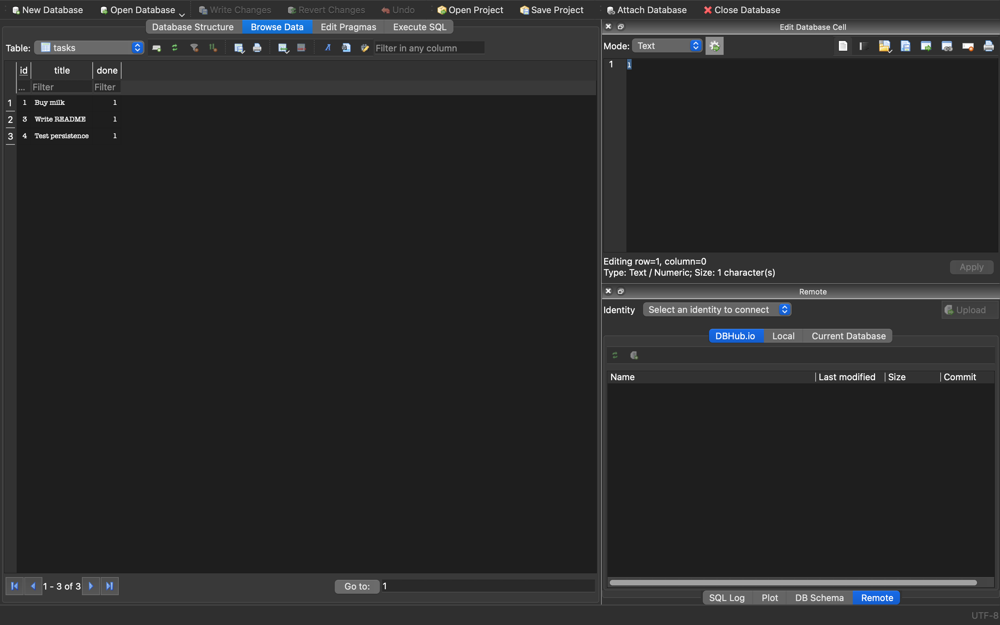
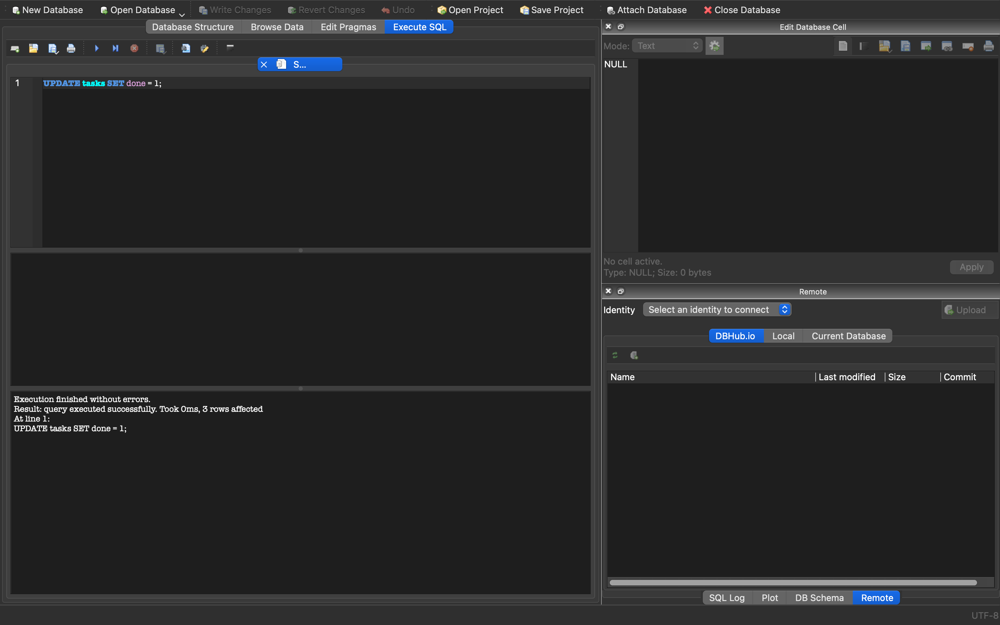
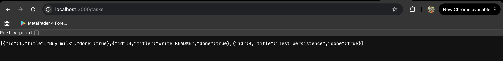

# Task API

A small CRUD API for managing a to-do list. Built with Node.js, Express and SQLite.

## What this is

Endpoints implementing full CRUD on a list of tasks. Tasks are stored in a
**SQLite database** (`tasks.db`), so your data survives server restarts.

The API is identical to the earlier in-memory version: same URLs, same request
bodies, same responses. Only the storage layer changed.

```
Client -> API (Express) -> SQLite database (tasks.db)
```

## Why SQLite?

- **No server to install or run.** The whole database is a single file, so
  anyone who clones this repo can run it with just `npm install`.
- **Real SQL.** It is a proper relational database, so the skills transfer
  directly to PostgreSQL, MySQL or SQL Server later.
- **Great for small projects.** Fast, reliable and well supported by the
  `better-sqlite3` library.

## Where the database file is stored

The database is the file **`tasks.db`** in the project root, next to
`server.js`. It is created automatically the first time the server starts, and
the `tasks` table is created if it is missing. Three example tasks are inserted
only when the table is empty, so they appear once and never duplicate.

`tasks.db` is listed in `.gitignore`, so each person who clones the repo gets
their own fresh database.

### Schema

| Column  | Type                      | Notes                                   |
|---------|---------------------------|-----------------------------------------|
| `id`    | INTEGER PRIMARY KEY       | Auto-incrementing                       |
| `title` | TEXT, NOT NULL            | The task description                    |
| `done`  | INTEGER, NOT NULL, 0 or 1 | SQLite has no boolean, so 0 = false, 1 = true. The API converts it to `true`/`false`. |

## How to run it

```bash
npm install
npm start
```

The server starts on **http://localhost:3000**. On first run, `tasks.db` is
created automatically. To stop the server, press `Ctrl+C`.

## Endpoints

| Method | Path         | Description                          | Success | Errors            |
|--------|--------------|---------------------------------------|---------|--------------------|
| GET    | /            | API description                       | 200     | -                  |
| GET    | /health      | Health check                          | 200     | -                  |
| GET    | /tasks       | List all tasks                        | 200     | -                  |
| GET    | /tasks/:id   | Get one task                          | 200     | 404                |
| POST   | /tasks       | Create a task (`{ "title": "..." }`)  | 201     | 400                |
| PUT    | /tasks/:id   | Update title and/or done              | 200     | 400, 404           |
| DELETE | /tasks/:id   | Remove a task                         | 204     | 404                |

## Example: curl -i output

```
$ curl -i http://localhost:3000/tasks/1
HTTP/1.1 200 OK
X-Powered-By: Express
Content-Type: application/json; charset=utf-8

{"id":1,"title":"Buy milk","done":false}
```

## Exploring the database

I opened `tasks.db` in [DB Browser for SQLite](https://sqlitebrowser.org/) and
ran SQL directly against it. The API reflects those changes immediately,
because the server reads from the database on every request.

### The table in DB Browser



### Example SQL query I executed

```sql
UPDATE tasks SET done = 1;
```



The query reported "3 rows affected". Reloading `GET /tasks` then showed every
task with `"done": true`:



Other queries I tried:

```sql
SELECT * FROM tasks;                  -- list every task
SELECT * FROM tasks WHERE done = 1;   -- completed tasks only
SELECT COUNT(*) FROM tasks;           -- count all tasks
DELETE FROM tasks WHERE done = 1;     -- delete all completed tasks
```

## Swagger UI

Interactive docs live at **http://localhost:3000/docs**


