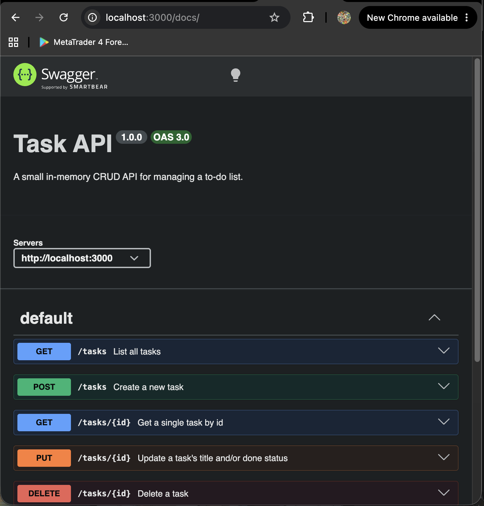

# Task API

A small in-memory CRUD API for managing a to-do list. Built with Node.js and Express.

## What this is

Four endpoints (plus root/health) implementing full CRUD on an in-memory list of tasks.
No database — data resets every time the server restarts.

## How to run it

```bash
npm install
npm start
```

The server starts on **http://localhost:3000**.

## Endpoints

| Method | Path         | Description                          | Success | Errors            |
|--------|--------------|---------------------------------------|---------|--------------------|
| GET    | /            | API description                       | 200     | -                  |
| GET    | /health      | Health check                          | 200     | -                  |
| GET    | /tasks       | List all tasks                        | 200     | -                  |
| GET    | /tasks/:id   | Get one task                          | 200     | 404                |
| POST   | /tasks       | Create a task (`{ "title": "..." }`)  | 201     | 400                |
| PUT    | /tasks/:id   | Update title and/or done              | 200     | 400, 404           |
| DELETE | /tasks/:id   | Remove a task                         | 204     | 404                |

## Example: curl -i output

$ curl -i http://localhost:3000/tasks/1
HTTP/1.1 200 OK
X-Powered-By: Express
Content-Type: application/json; charset=utf-8

{"id":1,"title":"Buy milk","done":false}

## Swagger UI

Interactive docs live at **http://localhost:3000/docs** 


