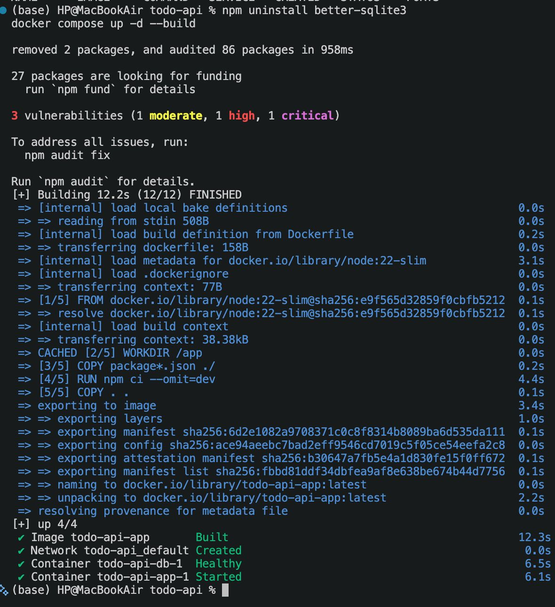
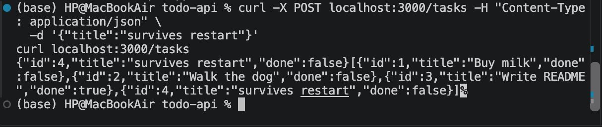
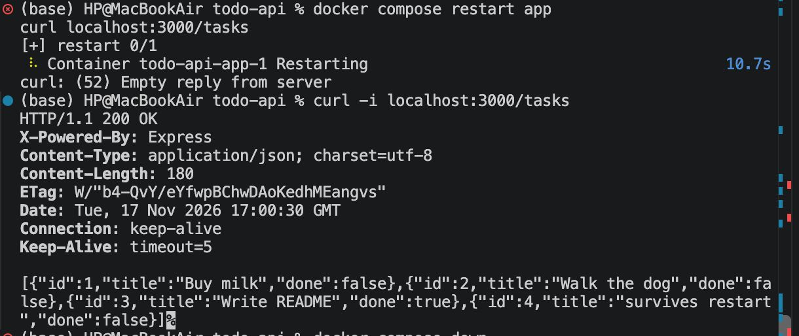
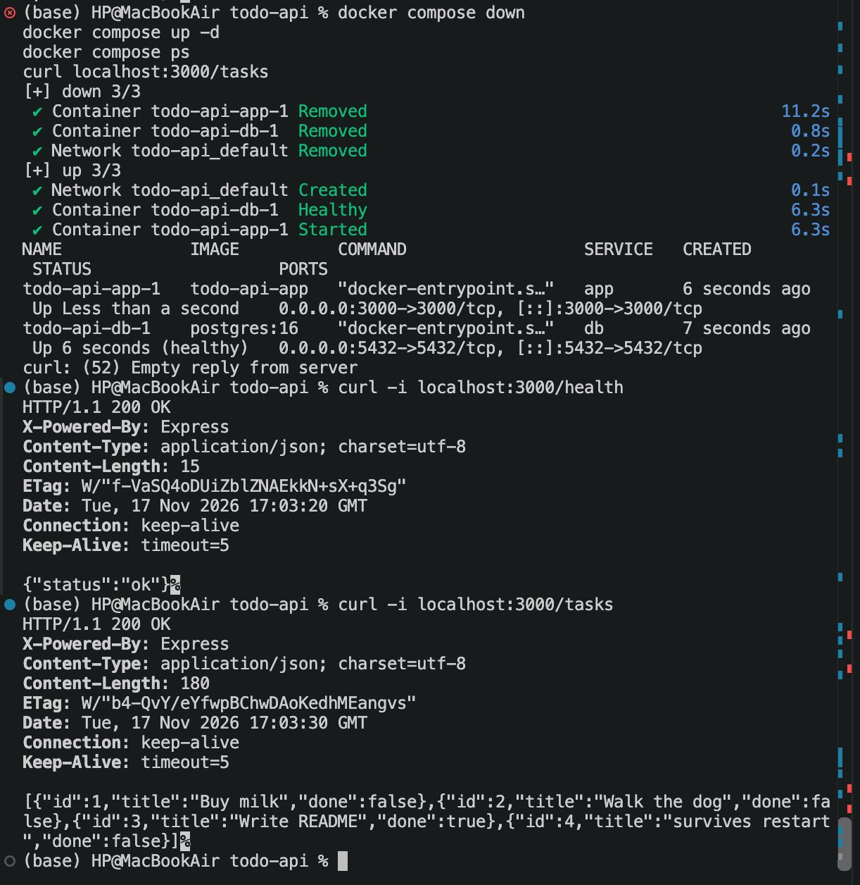
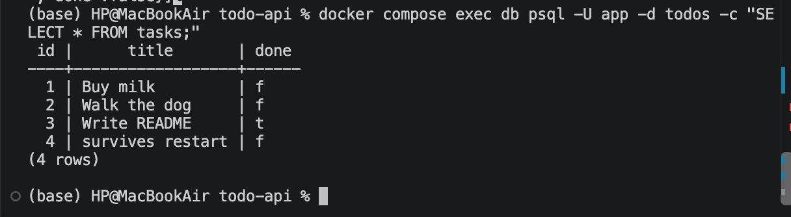
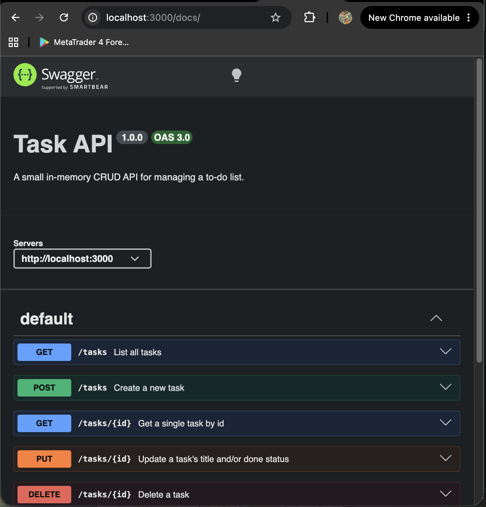
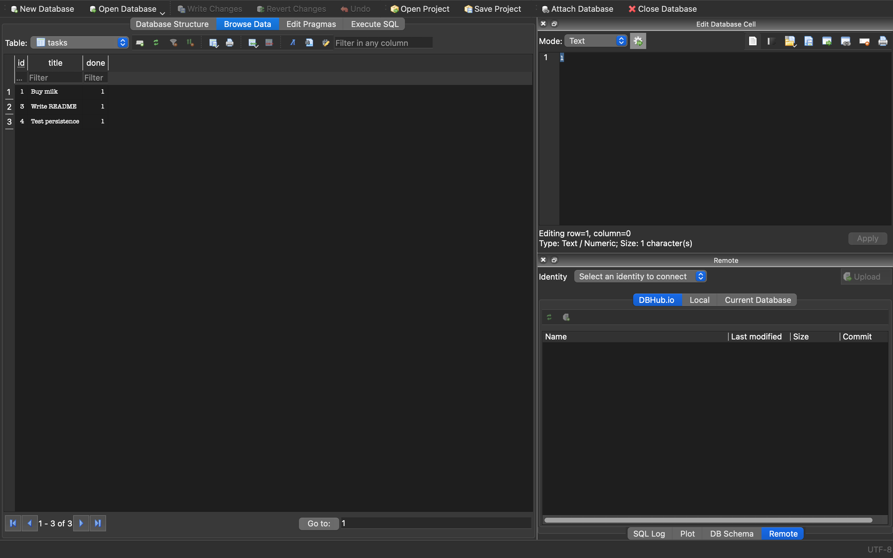
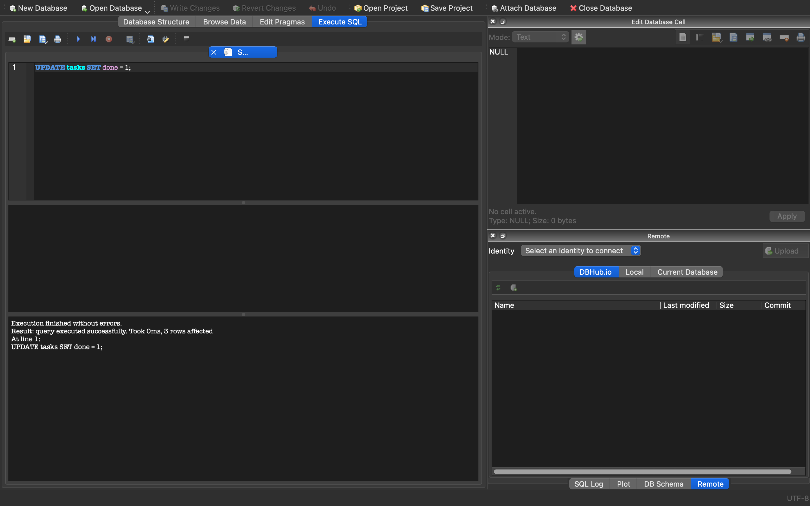
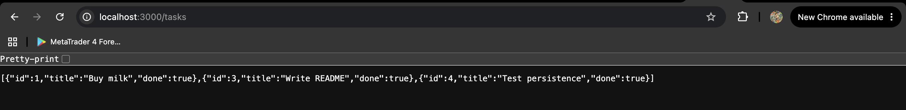

# Task API

A small CRUD API for managing a to-do list. Built with Node.js, Express and **PostgreSQL running in Docker**.

## What this is

Endpoints implementing full CRUD on a list of tasks. Tasks are stored in a
**PostgreSQL database** that runs in a Docker container with a named volume, so
data survives app restarts and container removal.

The API is identical to the earlier versions (in-memory, then SQLite): same
URLs, same request bodies, same responses. Only the storage layer changed.

```
Client -> API (Express, container "app") -> PostgreSQL (container "db") -> volume "pgdata"
```

## How to run it

Requires Docker (I used [OrbStack](https://orbstack.dev/), which provides the
same `docker` and `docker compose` commands).

```bash
cp .env.example .env      # then edit the values if you like
docker compose up --build
```

The API is then at **http://localhost:3000** and the docs at
**http://localhost:3000/docs**. Add `-d` to run in the background, and use
`docker compose down` to stop (this keeps the data).

### Running the app outside Docker (optional)

```bash
docker compose up -d db   # start only the database
npm install
npm start                 # uses DATABASE_URL from .env (host is localhost)
```

### Environment variables

Configuration lives in `.env`, which is **gitignored**. `.env.example` is
committed with placeholder values.

| Variable            | Purpose                                              |
|---------------------|------------------------------------------------------|
| `POSTGRES_USER`     | Database user (used by the `db` container)           |
| `POSTGRES_PASSWORD` | Database password                                    |
| `POSTGRES_DB`       | Database name                                        |
| `DATABASE_URL`      | Connection string used when running the app locally  |

Inside Docker Compose the app gets its own `DATABASE_URL` whose host is `db`
(the service name) instead of `localhost`, because inside the app container
`localhost` would be the app itself.

## Database

The table is created by `db/init.sql`, which Compose mounts into
`/docker-entrypoint-initdb.d/`. Postgres runs it **only the first time**, when
the `pgdata` volume is empty. It also inserts three example tasks.

### Schema

| Column  | Type                      | Notes                                  |
|---------|---------------------------|----------------------------------------|
| `id`    | SERIAL PRIMARY KEY        | Auto-incrementing                      |
| `title` | TEXT, NOT NULL            | The task description                   |
| `done`  | BOOLEAN, NOT NULL, FALSE  | Real boolean (SQLite used 0/1)         |

To deliberately reset the database (this **deletes all data**):

```bash
docker compose down -v
docker compose up --build
```

## Architecture: swapping the storage

Data access lives behind a small repository interface:

| Method                    | Returns                                  |
|---------------------------|------------------------------------------|
| `findAll()`               | array of `{id, title, done}`             |
| `findById(id)`            | task or `null`                           |
| `create(title)`           | the new task                             |
| `update(id, title, done)` | the updated task, or `null` if not found |
| `remove(id)`              | `true` if deleted, `false` otherwise     |

The wiring is in one place at the top of `server.js`:

```js
const repo = createPostgresTaskRepository(process.env.DATABASE_URL);
```

**Being honest about what changed:**

- **The routes were refactored once, in a separate step.** In Assignment 2 the
  SQL was written directly inside `server.js`, so there was no repository to
  swap. I extracted a `sqliteTaskRepository` and made the interface `async`
  (SQLite's driver is synchronous, Postgres's `pg` driver is asynchronous).
  That refactor changed `server.js`, committed as `refactor: extract task
  repository`, and I checked every endpoint still behaved the same.
- **The SQLite to Postgres swap then changed only the repository and the
  wiring.** I added `repositories/postgresTaskRepository.js` and changed the
  `require` and `repo` lines in `server.js` (plus `require("dotenv").config()`
  at the top). The route handlers and validation were not touched.
- Other changes were infrastructure only: `Dockerfile`, `docker-compose.yml`,
  `.dockerignore`, `db/init.sql`, `.env.example`, and swapping the
  `better-sqlite3` dependency for `pg` and `dotenv`.

## Persistence proof

Run on OrbStack with `docker compose`. The data lives in the named volume
`pgdata`, not in the container.

### 1. Start the whole stack with one command

```bash
docker compose up -d --build
```



Both containers started. `db` reported **Healthy** before `app` started,
because of the healthcheck and `depends_on: condition: service_healthy`.

### 2. Create a task

```bash
curl -X POST localhost:3000/tasks -H "Content-Type: application/json" \
  -d '{"title":"survives restart"}'
curl localhost:3000/tasks
```



The new task got `id: 4` and appears in the list next to the three seed tasks.

### 3. Restart the app container

```bash
docker compose restart app
curl -i localhost:3000/tasks
```



The first `curl` ran while the app was still restarting and returned
`Empty reply from server`. Retrying a few seconds later returned `200 OK` with
all four tasks, including "survives restart".

### 4. Remove all containers and recreate them

```bash
docker compose down        # removes containers and network, keeps the volume
docker compose up -d       # brand-new containers
docker compose ps
curl -i localhost:3000/tasks
```



Again the first `curl` was too early (the app had been up for less than a
second). Once it was ready, `/health` returned `ok` and `/tasks` returned all
four tasks. The containers were brand new, so the data must come from the
volume.

### 5. Check the database directly

```bash
docker compose exec db psql -U app -d todos -c "SELECT * FROM tasks;"
```



The row "survives restart" is stored in Postgres itself (`done` shows as `f`/`t`
because Postgres has a real boolean type).

**Conclusion:** the task created before the app restart and before
`docker compose down` was still there afterwards, so the data persists across
both an app restart and a full container teardown. I never used
`docker compose down -v`, which would have deleted the volume.

## Endpoints

| Method | Path         | Description                          | Success | Errors            |
|--------|--------------|---------------------------------------|---------|--------------------| 
| GET    | /            | API description                       | 200     | -                  |
| GET    | /health      | Health check                          | 200     | -                  |
| GET    | /tasks       | List all tasks                        | 200     | -                  |
| GET    | /tasks/:id   | Get one task                          | 200     | 404                |
| POST   | /tasks       | Create a task (`{ "title": "..." }`)  | 201     | 400                |
| PUT    | /tasks/:id   | Update title and/or done              | 200     | 400, 404           |
| DELETE | /tasks/:id   | Remove a task                         | 204     | 404                |

Unexpected errors return `500 {"error": "Internal server error"}`.

### Example: curl -i output

```
$ curl -i http://localhost:3000/tasks/1
HTTP/1.1 200 OK
X-Powered-By: Express
Content-Type: application/json; charset=utf-8

{"id":1,"title":"Buy milk","done":false}
```

## Swagger UI

Interactive docs live at **http://localhost:3000/docs**



## History: Assignment 2 (SQLite)

Before moving to Postgres, tasks were stored in a single SQLite file
(`tasks.db`) using `better-sqlite3`. I explored it with
[DB Browser for SQLite](https://sqlitebrowser.org/) and ran SQL directly
against it. That code is still in the git history.



```sql
UPDATE tasks SET done = 1;
```



The query reported "3 rows affected", and `GET /tasks` then showed every task
with `"done": true`:



The same kind of SQL works against Postgres, for example:

```bash
docker compose exec db psql -U app -d todos -c "SELECT * FROM tasks WHERE done = true;"
```